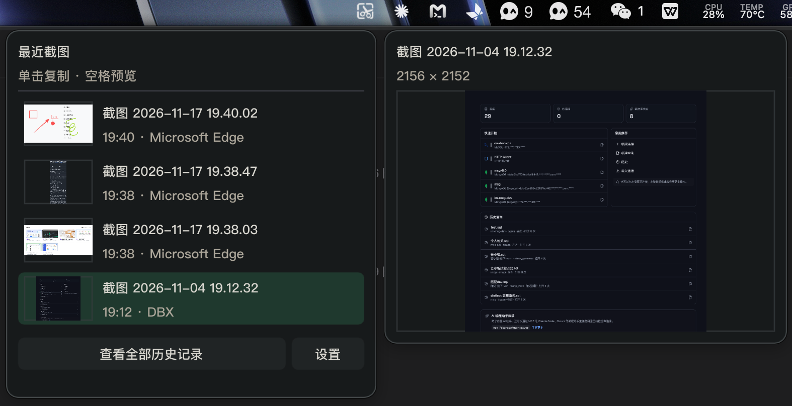
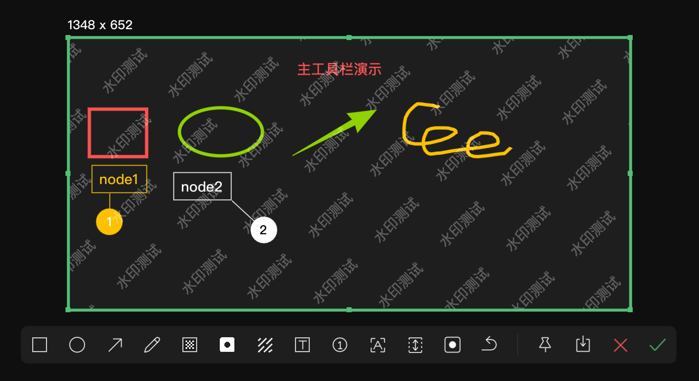
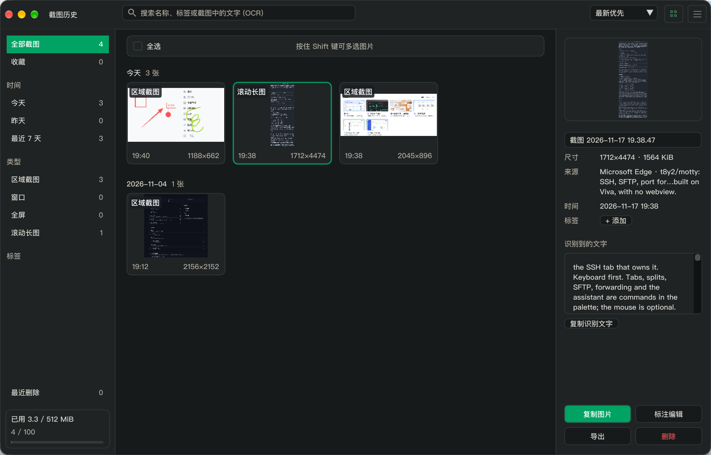
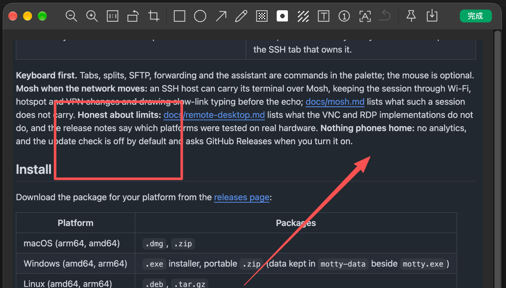
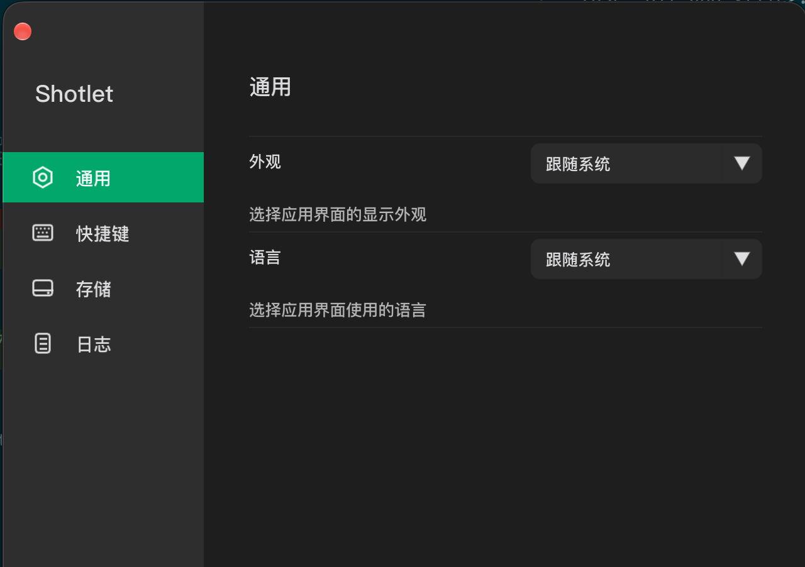

# Shotlet

<div align="center">
  <p><a href="README.md">English</a> | <a href="README.zh-CN.md">简体中文</a></p>
  <p><strong>A native screenshot and annotation tool for desktop workflows</strong></p>
  <p>Capture multiple displays, stitch long pages, annotate, search with OCR, manage screenshot history, and record selected regions.</p>
  <p><a href="assets/app-tray.png"></a></p>
  <p><sub>Browse recent captures, preview an image, copy it, or open the full history.</sub></p>
</div>

Shotlet is built with C++20, SDL3, Dear ImGui, and SDL_GPU. Windows and macOS are the supported desktop platforms. The project also provides a Node-API addon for Electron and a C SDK for Go, C, and C++ hosts.

**Tiny and portable.** The whole app fits in a ZIP of about 1–2 MB (v0.1.0). Unzip and go: no installer, nothing running in the background.

**Fully offline, your data stays yours.** Shotlet never talks to a server. No uploads, no telemetry, no accounts, no cloud sync. Your screenshots, recordings, OCR text, history, and settings never leave your machine.

Version tags trigger GitHub Actions builds of portable ZIP packages for Windows x64, macOS Apple Silicon, and macOS Intel. Once a release is published, download the matching ZIP and `SHA256SUMS` from the repository's Releases page. Extract the Windows package and run `shotlet.exe`; on macOS, move `shotlet.app` to Applications. macOS packages use ad-hoc signing and are not notarized; Windows packages are unsigned. See [RELEASING.md](RELEASING.md) for the release process, or build from source below. Linux has partial build support, but desktop capture and system integration are incomplete and Linux is not an officially supported platform.

<table>
  <tr>
    <td width="50%" valign="top"><a href="assets/app-main.png"></a></td>
    <td width="50%" valign="top"><a href="assets/app-history.png"></a></td>
  </tr>
  <tr>
    <td width="50%" valign="top"><a href="assets/app-re-edit.png"></a></td>
    <td width="50%" valign="top"><a href="assets/app-settings.png"></a></td>
  </tr>
</table>

## Why Shotlet?

| Capture and annotate | Keep long content |
| --- | --- |
| Select windows or regions across displays, then add shapes, arrows, text, mosaics, highlights, or numbered callouts. Copy, save as PNG, or pin the result above the desktop. | Capture scrollable pages and manage results in searchable history. OCR text, tags, favorites, batch export, and re-editing are built in. |
| Record a region | Integrate with your app |
| Record MP4 or GIF with optional system audio, microphone, camera picture-in-picture, and cursor display. | Use the Node-API addon from Electron, or the C SDK from Go, C, and C++ hosts. |

SDL_GPU uses Metal on macOS and Direct3D 12 on Windows. Capture history and preferences stay on the local machine; the Node addon does not automatically add captures to history.

## Features

### Capture and annotation

- Multi-display capture with Retina and high-DPI coordinate handling.
- Window detection with hover highlighting and double-click selection.
- Resizable and movable regions, plus a pixel magnifier and color picker.
- Rectangle, ellipse, arrow, brush, mosaic, highlight, text, and numbered-callout layers.
- CJK input methods, multiline text editing, undo, and layer selection, movement, resizing, and styling.
- Copy to the system clipboard, save as PNG, or pin the result in a desktop window.
- OCR with a native results window.
- Scroll capture and long-image editing on Windows and macOS. macOS uses ScreenCaptureKit and matches frames asynchronously while scrolling.

### Recording selected regions

Choose MP4 or GIF and independently enable system audio, microphone, camera, and cursor display. A persistent selection border stays outside the recorded image. The camera preview is composited into the recording; screenshot annotations are not.

MP4 uses H.264 at a target of 30 fps. GIF targets 10 fps and has no audio. Recordings use the selected region's pixel dimensions and are saved in the system Videos folder under `Shotlet`. A preview opens after saving. Recording supports Windows and macOS 15 or later; macOS screenshots require macOS 13.3 or later.

On macOS, an Electron host must declare `NSMicrophoneUsageDescription` and/or `NSCameraUsageDescription` in its `Info.plist` to trigger the corresponding first-use permission prompt. A non-bundled `node` process cannot display these prompts; grant permissions from a host application bundle.

### Screenshot history

The recent-captures popover offers quick previews and copying. The full history window supports search by name, tags, and OCR text; filtering by date, type, favorites, or tags; grid and list views; batch export; and long-image stitching. Captures can be renamed, tagged, restored from Recently Deleted, or reopened for annotation. History is enabled by default in the standalone app and is not used by the Node addon.

## Build

### Requirements

- CMake 3.20 or later and a C++20 compiler.
- SDL 3.4.18 source code and the pinned Dear ImGui source revision.
- Node.js headers to build the Node addon; Windows also requires `node.lib`.
- GoogleTest to build the full test suite.

Recommended toolchains are Visual Studio 2019, 2022, or 2026 with x64 C++ tools on Windows, and Xcode Command Line Tools on macOS. Third-party versions and license texts are listed in [THIRD_PARTY_NOTICES.md](THIRD_PARTY_NOTICES.md).

### Get dependencies

Run these commands from the repository root:

```bash
git clone --branch release-3.4.18 --depth 1 https://github.com/libsdl-org/SDL.git sdl3
git clone https://github.com/ocornut/imgui.git imgui
git -C imgui checkout e05bd9deb9a73b67acb5c04b8a581e06a2d42657
```

The ImGui revision is pinned to a tested commit. Update it together with the CI build checks.

### Quick build

On macOS:

```bash
./build.sh          # Build the app
./build.sh --node   # Build the Node-API addon
./build.sh --tests  # Build tests
./build.sh --all    # Build all targets
```

On Windows, `build.ps1` detects an installed Visual Studio CMake generator:

```powershell
.\build.ps1          # Build the app
.\build.ps1 --node   # Build the Node-API addon
.\build.ps1 --tests  # Build tests
.\build.ps1 --all    # Build all targets
```

To build tests on Windows, install GoogleTest with vcpkg and set `VCPKG_ROOT`:

```powershell
vcpkg install gtest:x64-windows
$env:VCPKG_ROOT = "C:\path\to\vcpkg"
.\build.ps1 --tests
```

The `windows` CMake preset currently uses Visual Studio 2026. For Visual Studio 2022, use `build.ps1` or select the `Visual Studio 17 2022` generator manually.

### Manual CMake build

```bash
cmake -S . -B build \
  -DCMAKE_BUILD_TYPE=Release \
  -DSDL3_DIR="$PWD/sdl3" \
  -DIMGUI_DIR="$PWD/imgui" \
  -DSHOTLET_BUILD_TESTS=OFF \
  -DSHOTLET_BUILD_NODE_ADDON=OFF

cmake --build build --target shotlet --parallel
```

The main options are `SHOTLET_BUILD_TESTS`, `SHOTLET_BUILD_NODE_ADDON`, `NODE_INCLUDE_DIR`, and `NODE_LIBRARY`. CMake skips the test target when GoogleTest is unavailable and skips the addon when `node_api.h` cannot be found.

During configuration, CMake applies the SDL patch at `cmake/patches/disable-sdl-dynamic-api.patch`. Git must be installed and `SDL3_DIR` must point to a writable source directory. This disables replacing the bundled SDL at runtime through `SDL3_DYNAMIC_API`; rebuild the app when updating SDL.

| Target | macOS | Windows |
| --- | --- | --- |
| App | `build/shotlet.app` and `build/shotlet` launcher | `build/Release/shotlet.exe` |
| Node addon | `build/native/darwin-arm64/shotlet.node` and `build/native/darwin-x64/shotlet.node` | `build/Release/shotlet.node` |
| Tests | `build/tests/shotlet_tests` | `build/tests/Release/shotlet_tests.exe` |

## Run

Running the app starts region capture. Add `--daemon` to keep it in the background and trigger capture with the global shortcut (`Cmd+Shift+A` on macOS, `Win+Shift+A` on Windows):

```bash
./build/shotlet
./build/shotlet --daemon
./build/shotlet --daemon --foreground  # Keep the daemon attached for debugging
```

The tray or status-bar menu provides recent captures, full history, settings, and quit. Settings include appearance, language, shortcuts, and history storage. The app supports Simplified Chinese and English, light and dark themes, and following the system preference.

macOS may require Screen Recording permission for capture and Accessibility permission for global shortcuts or window detection. Windows recording requires the relevant system media components and device permissions.

## Electron / Node-API

Build the addon with `./build.sh --node` or `build.ps1 --node`, then load the platform-specific `shotlet.node` in the Electron main process:

```js
const path = require('node:path')
const shotlet = require(path.resolve(__dirname, 'shotlet.node'))

shotlet.configure({
  logDir: path.resolve(__dirname, 'logs'),
  logLevel: 'info',
  consoleLog: false
})

const result = shotlet.capture()
```

`configure()` accepts `language`, `theme`, `logDir`, `logLevel`, `consoleLog`, and `consoleLogLevel`. `capture()` is synchronous and blocks the calling Node.js thread until the capture UI closes; consider invoking it from a separate process.

```ts
type CaptureResponse = {
  code: 0 | 1 | 2
  status: 'success' | 'error' | 'cancelled'
  ok: 0 | 1
  result?: {
    type: 'pin' | 'ocr'
    image: Buffer
    imageWidth: number
    imageHeight: number
    rowPitch: number
    text: string
    selection: Bounds
    window: Bounds
  }
}
```

The addon returns image data for Pin and OCR actions; a normal completion returns only a status. On macOS, package the addon matching the Electron architecture (`darwin-arm64` or `darwin-x64`) and configure the host app's system permissions.

## Capture SDK

Go, C, and C++ hosts can export a standalone C SDK and helper process using:

```bash
python3 scripts/export-capture-sdk.py
```

The host mode returns selected-region images, supports OCR, pinning, saving, and recording, and leaves history, tray, global shortcuts, and clipboard output to the host. See [docs/capture-sdk.md](docs/capture-sdk.md) for the ABI, helper protocol, permissions, and resource lifetime contract.

## Tests

```bash
./build.sh --tests
ctest --test-dir build --output-on-failure
node tests/test_node_addon_smoke.js
```

The tests cover canvas and layer interaction, text input, region detection, capture data, overlay lifecycle, history, recording, and platform utilities. Some window, OCR, and permission tests require a real desktop session and system services.

## Logs and troubleshooting

The log file is named `runtime.log`:

- macOS: `~/Library/Logs/Shotlet/runtime.log`
- Windows: a writable application data directory
- Node addon: set `logDir` in `configure()`

Use `--log-level debug` to enable detailed logs. A log-directory creation failure does not prevent the app from starting.

### CMake cannot find SDL3 or ImGui

Check that `sdl3` and `imgui` are in the repository root, or set `SDL3_DIR` and `IMGUI_DIR` explicitly.

### macOS capture is black

Grant Screen Recording permission to the actual host launching Shotlet. For Electron, authorize the Electron app rather than a standalone command-line binary.

### Windows OCR is unavailable

The build requires Windows SDK C++/WinRT headers. If CMake cannot find `winrt/base.h`, OCR will be unavailable.

### Windows test target is missing

Install `gtest:x64-windows` with vcpkg, set `VCPKG_ROOT`, and reconfigure the build directory.

## License

Shotlet is distributed under the [Apache License 2.0](LICENSE). Third-party components retain their respective licenses; see [THIRD_PARTY_NOTICES.md](THIRD_PARTY_NOTICES.md).
