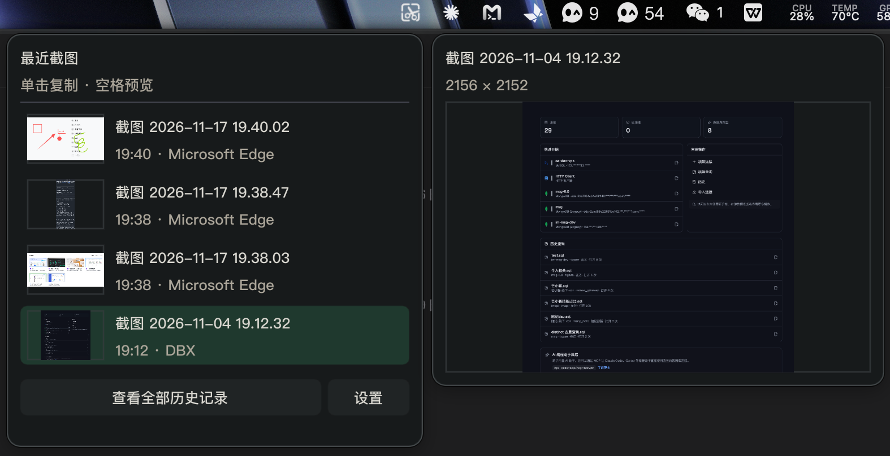
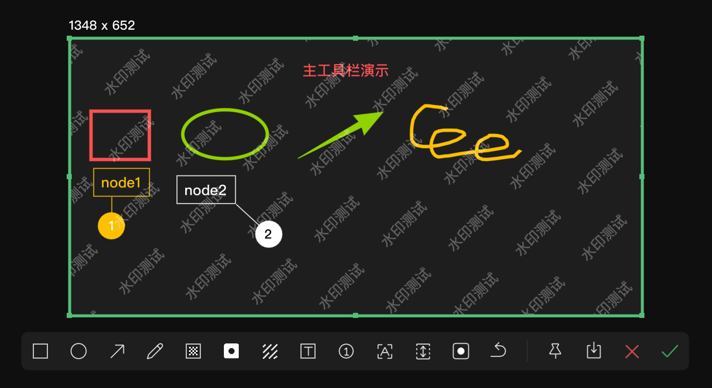
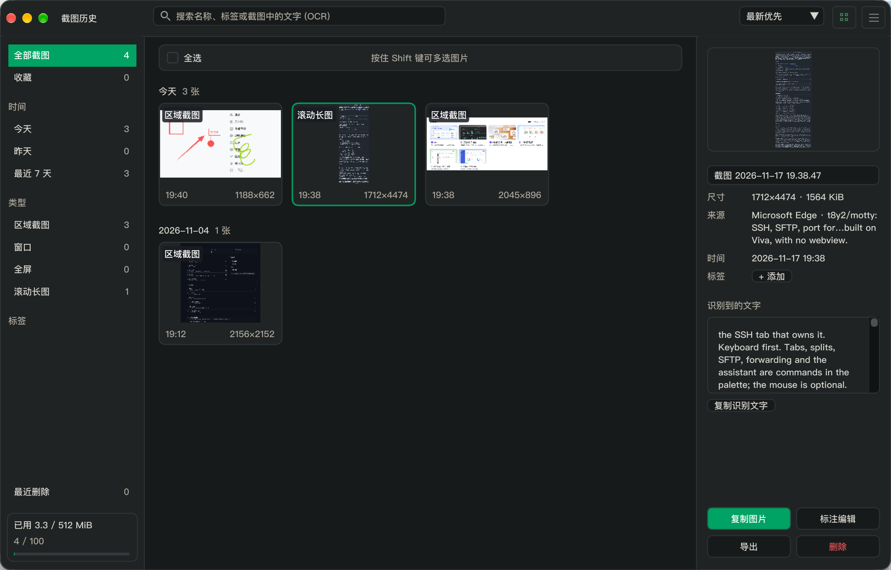
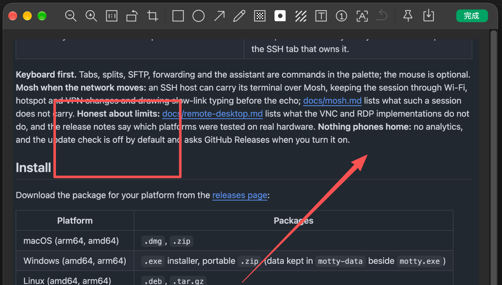
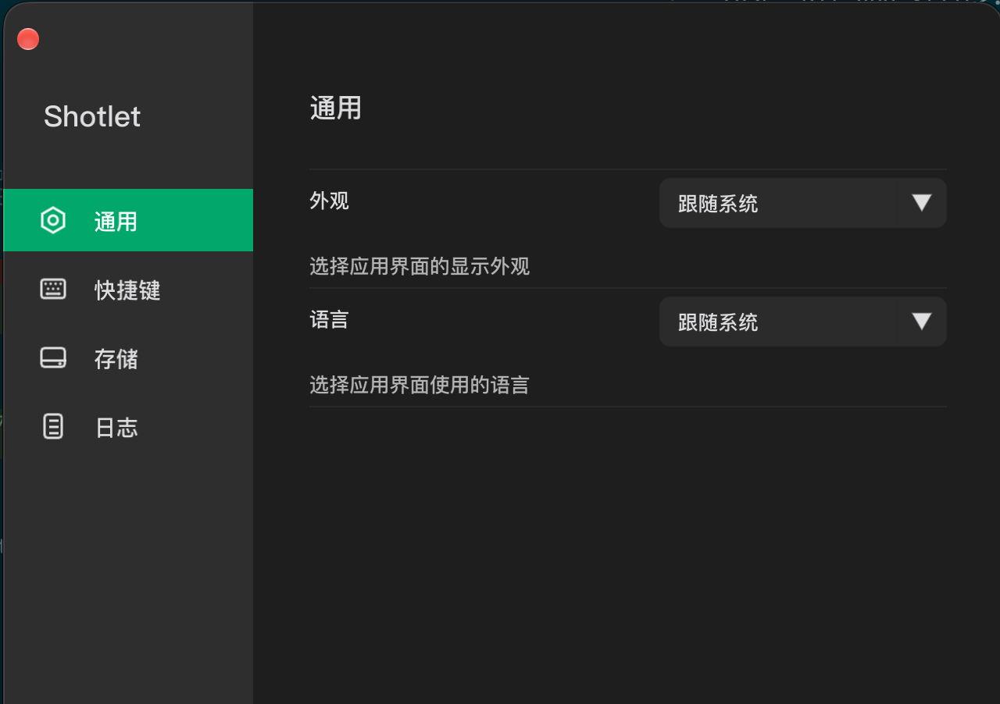

# Shotlet

<div align="center"><a href="README.md">English</a> | 简体中文</div>

<div align="center">
  <p><strong>一款面向桌面工作流的截图与标注工具</strong></p>
  <p>从多屏捕获、滚动长图到标注、OCR、历史管理和选区录屏，在一个轻量原生应用中完成。</p>
  <p><a href="assets/app-tray.png"></a></p>
  <p><sub>最近截图弹层：浏览并预览截图，快速复制或打开完整历史。</sub></p>
  <p><a href="#功能">功能介绍</a> · <a href="#获取依赖">获取依赖</a> · <a href="#快速构建">快速构建</a> · <a href="#electron--node-api">Node-API</a> · <a href="#截图-sdk-与宿主运行时">截图 SDK</a> · <a href="#使用案例">使用案例</a></p>
</div>

Shotlet 使用 C++20、SDL3、Dear ImGui 和 SDL_GPU 构建，支持 Windows 与 macOS，并提供可供 Electron/Node.js 主进程加载的 Node-API addon，以及供 Go、C、C++ 宿主集成的截图 SDK。

**小巧便携，解压即用。** 整个应用打包后只有 1–2 MB 左右（v0.1.0），不用安装，也没有常驻后台。

**完全离线，数据只属于你。** Shotlet 不连接任何服务器：不上传、不收集遥测、不要账号、没有云同步。截图、录屏、OCR 结果、历史记录和设置，全部只留在你自己的电脑上。

推送版本标签后，GitHub Actions 会自动构建 Windows x64、macOS Apple Silicon 和 macOS Intel 的便携 ZIP 包。版本发布后，可在仓库的 Releases 页面下载对应 ZIP 和 `SHA256SUMS` 校验文件。Windows 解压后运行 `shotlet.exe`；macOS 将 `shotlet.app` 移入“应用程序”。macOS 产物采用临时签名（ad-hoc），尚未公证；Windows 产物未做代码签名。发布流程见 [RELEASING.md](RELEASING.md)，也可按下方说明从源码构建。

<table>
  <tr>
    <td width="50%" valign="top">
      <a href="assets/app-main.png"></a>
    </td>
    <td width="50%" valign="top">
      <a href="assets/app-history.png"></a>
    </td>
  </tr>
  <tr>
    <td width="50%" valign="top">
      <a href="assets/app-re-edit.png"></a>
    </td>
    <td width="50%" valign="top">
      <a href="assets/app-settings.png"></a>
    </td>
  </tr>
</table>

## 为什么选择 Shotlet？

<table>
  <tr>
    <td width="50%" valign="top">
      <p><strong>捕获后直接处理。</strong>智能窗口选区、多显示器与高 DPI 坐标处理，配合形状、文字、马赛克、数字标记和高亮工具；结果可复制、保存为 PNG 或贴在桌面。</p>
    </td>
    <td width="50%" valign="top">
      <p><strong>长内容也能留住。</strong>滚动截图用于采集超出屏幕的页面，截图历史支持 OCR 搜索、标签、收藏、批量导出和重新编辑。</p>
    </td>
  </tr>
  <tr>
    <td width="50%" valign="top">
      <p><strong>录制选区而非整块桌面。</strong>可录制 MP4 或 GIF，按需采集系统声音、麦克风、摄像头画中画和鼠标指示。</p>
    </td>
    <td width="50%" valign="top">
      <p><strong>可嵌入现有应用。</strong>Electron 可通过 Node-API 调用；Go、C、C++ 宿主可使用截图 SDK。宿主模式支持显式管理权限和图片生命周期。</p>
    </td>
  </tr>
</table>

**原生渲染。** SDL_GPU 在 macOS 使用 Metal，在 Windows 使用 Direct3D 12；不依赖浏览器内核。
**边界清晰。** Windows 与 macOS 是正式支持平台；Linux 目前仅保留部分编译适配，桌面捕获和系统集成能力不完整。
**本地优先。** 截图历史和设置保存在本机；Node addon 不自动记录历史。

## 功能

### 截图与编辑

- 多显示器截图，每个屏幕使用独立 Overlay，并处理 Retina/高 DPI 坐标换算
- 智能窗口区域识别，鼠标悬停高亮窗口，双击快速确认选区
- 可移动、缩放的截图选区和尺寸提示
- 鼠标放大镜、像素颜色显示及颜色复制
- 标注工具：矩形、椭圆、箭头、画笔、马赛克、高亮、文字、数字打点
- 高亮支持矩形/椭圆区域，框内保持原图、框外压暗；多个区域合并显示，遮罩透明度默认 50%，支持拖动、缩放、撤销与历史恢复
- 数字打点支持连续编号、删除后自动重排、颜色及三档尺寸调整；新增后自动输入说明，点击框外结束输入，再次点击空白继续打点，双击说明框可重新编辑
- 数字圆点与说明框可分别拖动，连线自动调整边缘触点；说明框无四角手柄，使用与圆点同色的实线边框，边框和连线随截图导出
- 图层选择、移动、缩放、改色、调整粗细、填充和撤销
- CJK 输入法支持、多行文字编辑、文字选择和双击重新编辑
- 将结果复制到系统剪贴板或通过系统对话框保存为 PNG
- 将截图作为置顶窗口贴在桌面
- OCR 文字识别及原生结果窗口
- 滚动截图与长图编辑（Windows、macOS）
- 选区录屏，支持 MP4／GIF、声音开关、摄像头画中画和持续边框（Windows、macOS 15+）
- 后台常驻、系统托盘退出菜单和全局快捷键触发截图
- Node-API addon，可嵌入 Electron 主进程并返回 Pin/OCR 结果数据
- 简体中文与英文界面，支持跟随系统语言或通过 CLI / addon 显式选择
- 亮色／深色界面，支持跟随系统、CLI / addon 配置和后台托盘手动切换

## 界面操作

工具栏从左到右提供：

1. 矩形、椭圆、箭头、画笔、马赛克、文字和数字打点标注
2. OCR 文字提取
3. 滚动截图（Windows、macOS）
4. 选区录屏（Windows、macOS 15+）
5. 撤销
6. 贴图到桌面
7. 保存图片
8. 退出
9. 完成并复制到剪贴板

macOS 滚动截图采用 ScreenCaptureKit 连续区域采集，按用户输入拆分小步滚动，
在后台匹配真实画面位移；预览异步更新，匹配失败或处理落后时会暂停输入以保留重叠区域。
Windows 也支持滚动截图与长图编辑。

| 操作 | 功能 |
|------|------|
| 拖动空白区域 | 创建选区 |
| 拖动选区或控制点 | 移动或缩放选区 |
| 双击智能区域 | 直接确认该区域 |
| 双击文字图层 | 重新编辑文字 |
| `Esc` | 退出截图 |
| `Delete` / `Backspace` | 删除选中的图层 |
| `Ctrl+C` | Windows 截图界面中复制放大镜色值 |
| `Win+Shift+A` / `Cmd+Shift+A` | 后台模式触发截图 |

## 构建要求

- CMake 3.20+
- 支持 C++20 的编译器
- SDL3 3.4.18 或更新版本的源码目录
- Dear ImGui 源码目录
- 构建 Node addon 时需要 Node.js headers；Windows 还需要 `node.lib`
- 构建测试时需要 GoogleTest

第三方依赖版本与许可证见 [第三方依赖说明](THIRD_PARTY_NOTICES.md)。

推荐工具链：

| 平台 | 工具链 |
|------|--------|
| Windows | Visual Studio 2019、2022 或 2026，x64 C++ 工具 |
| macOS | Xcode Command Line Tools / Clang |

SDL3 在所有平台均静态链接，并关闭未使用的音频、摄像头、手柄、触觉、HID、电源、传感器、对话框和 SDL_Render 子系统，保留窗口、SDL_GPU 和系统托盘。macOS 使用 Metal，Windows 使用 Direct3D 12；两者均关闭 OpenGL、OpenGL ES 和 Vulkan。裁剪配置由根目录 CMake 统一应用于应用和 Node addon，并覆盖旧构建缓存。

## 获取依赖

项目通过源码目录直接引入 SDL3 和 ImGui：

```bash
git clone --branch release-3.4.18 --depth 1 https://github.com/libsdl-org/SDL.git sdl3
git clone https://github.com/ocornut/imgui.git imgui
git -C imgui checkout e05bd9deb9a73b67acb5c04b8a581e06a2d42657
```

ImGui 固定到已验证的提交；升级时请同步更新 CI 并运行两平台构建测试。

目录应满足：

```text
shotlet/
├── sdl3/include/SDL3/SDL.h
└── imgui/imgui.h
```

## 快速构建

### macOS

```bash
./build.sh          # 构建应用
./build.sh --node   # 构建 Node-API addon
./build.sh --tests  # 构建测试
./build.sh --all    # 构建全部目标
```

Linux 构建入口仍可用于编译检查，但 Linux 平台适配尚未列为正式支持平台；截图、窗口和系统集成能力可能不完整。

### Windows

构建脚本会自动探测已安装的 Visual Studio CMake generator：

```powershell
.\build.ps1          # 构建应用
.\build.ps1 --node   # 构建 Node-API addon
.\build.ps1 --tests  # 构建测试
.\build.ps1 --all    # 构建全部目标
```

测试依赖通过 vcpkg 查找。安装 GoogleTest 后设置 `VCPKG_ROOT`：

```powershell
.\vcpkg install gtest:x64-windows
$env:VCPKG_ROOT = "C:\path\to\vcpkg"
.\build.ps1 --tests
```

仓库也提供 `CMakePresets.json`：

```powershell
cmake --preset windows
cmake --build --preset windows

cmake --preset windows-vcpkg-tests
cmake --build --preset windows-vcpkg-tests
ctest --preset windows-vcpkg-tests
```

`windows` preset 当前使用 `Visual Studio 18 2026`。使用 Visual Studio 2022 时，优先运行 `build.ps1`，或手动指定 `Visual Studio 17 2022`。

## 手动 CMake 构建

```bash
cmake -S . -B build \
  -DCMAKE_BUILD_TYPE=Release \
  -DSDL3_DIR="$PWD/sdl3" \
  -DIMGUI_DIR="$PWD/imgui" \
  -DSHOTLET_BUILD_TESTS=OFF \
  -DSHOTLET_BUILD_NODE_ADDON=OFF

cmake --build build --target shotlet --parallel
```

主要选项：

| 选项 | 默认值 | 说明 |
|------|--------|------|
| `SDL3_DIR` | `./sdl3` | SDL3 源码目录 |
| `IMGUI_DIR` | `./imgui` | ImGui 源码目录 |
| `SHOTLET_BUILD_TESTS` | `ON` | 查找 GTest 并构建 `shotlet_tests` |
| `SHOTLET_BUILD_NODE_ADDON` | `ON` | 查找 Node headers 并构建 `shotlet.node` |
| `NODE_INCLUDE_DIR` | 自动查找 | 包含 `node_api.h` 的目录 |
| `NODE_LIBRARY` | 自动查找 | Windows 的 Node import library |

未找到 GTest 时，CMake 会跳过依赖 GTest 的测试目标；未找到 `node_api.h` 时，会跳过 Node addon。

Release / MinSizeRel 构建对 JSON 编解码、设置与历史界面、ImGui 和 SDL 按模块优化体积：GCC / Clang 使用 `-Os`，MSVC 使用 `/O1`。截图、画布和滚动拼接等其他应用模块保留构建类型的默认优化选项；Debug / RelWithDebInfo 不增加这些体积优化选项。

CMake 配置时通过 Git 检查并应用 `cmake/patches/disable-sdl-dynamic-api.patch`，关闭静态 SDL 的 Dynamic API，使链接器能够裁剪更多未使用实现。因此需要安装 Git，并保证 `SDL3_DIR` 指向可写源码目录。补丁已应用时不会重复修改；并行配置通过文件锁协调；依赖升级或本地修改导致补丁不匹配时配置会明确失败，需要核对源码并更新补丁。

关闭 Dynamic API 后不再支持通过 `SDL3_DYNAMIC_API` 环境变量替换内置 SDL。更新 SDL 需要重新构建并发布应用。该补丁不关闭 Metal、Direct3D 12、窗口、键鼠输入或系统托盘。

产物位置:

| 目标 | macOS | Windows                    |
|------|-------|----------------------------|
| 应用 | `build/shotlet.app`，并生成 `build/shotlet` 启动脚本 | `build/Release/shotlet.exe`  |
| Node addon | `build/native/darwin-arm64/shotlet.node` 和 `build/native/darwin-x64/shotlet.node` | `build/Release/shotlet.node` |
| 测试 | `build/tests/shotlet_tests` | `build/tests/Release/shotlet_tests.exe`  |

## 运行

直接运行即进入区域选择截图；使用 `--daemon` 常驻后台，通过全局快捷键开始截图。

macOS、Windows 左键点击状态栏／托盘图标，打开最近截图弹层，最多显示最近 8 张未删除记录的缩略图、名称和时间。悬停约 200 毫秒显示大图预览，靠近屏幕右侧时自动改到左侧；单击复制包含标注的完整图片，成功后关闭并恢复原应用焦点。支持方向键选择、空格切换预览、Enter／复制快捷键复制、Esc 关闭；右键记录可标注、另存或贴图。右键托盘图标保留完整历史、设置、复制最近一张和退出菜单。

托盘菜单的“截图历史”或弹层底部的“查看全部历史记录”提供三栏浏览界面：左侧按收藏、时间、截图类型或标签筛选，中间切换网格与列表、按日期分组，右侧显示预览、名称、来源和识别文字。支持搜索名称、标签和 OCR 文字，重命名、收藏、添加/移除标签，以及右键复制图片/文字、标注编辑、贴图和在文件夹中显示。文字在后台识别，旧记录打开历史窗口后也会补建索引。

通过列表顶部的全选栏，或使用 Ctrl/Command 多选、Shift 连选、Ctrl/Command+A 全选，可批量导出 PNG、添加标签或删除；“拼接长图”支持调整图片顺序、选择横向/纵向拼接，再进入编辑器。导出保留原 PNG，不覆盖目标目录中的同名文件。普通删除先移入“最近删除”，可以恢复或确认永久删除，保留 30 天；最近删除也计入最多 100 条、512 MiB 总额度，超限优先清理最近删除，再淘汰最旧截图。

复制、保存、贴图、OCR 成功后默认自动记录。普通单次运行也会记录，Node addon 不记录。历史窗口在打开、数据变更或最近删除到期时刷新，支持跨进程同步，空闲时不再定时全量读取元数据。历史保留选区内未标注的底图与图层，旧文字可重新编辑，马赛克可在关闭涂抹工具后点选并按 Delete/Backspace 删除。图层列表默认隐藏，保留为辅助选择入口；编辑器底部提供裁剪。历史中的直接复制、另存、贴图不重复记录，继续编辑或拼接后成功输出会产生新条目。

点击状态栏／系统托盘图标中的“设置…”打开设置窗口：

- **通用**：选择浅色、深色或跟随系统的外观，以及简体中文、English 或跟随系统的语言，修改自动保存。
- **快捷键**：每行配置一个操作。截图默认为 macOS 的 `⌘⇧A`、Windows 的 `Win+Shift+A`，打开截图历史默认为 `⌘⇧H`／`Win+Shift+H`。“复制最近一张截图”默认未设置，可自行录入。点击快捷键后直接按下新组合键，立即生效并保存；Esc 取消录入，Backspace／Delete 清除该快捷键。普通按键需搭配 Control、Alt 或 Command／Win，也可直接使用 F 功能键；不同操作不能使用相同组合键。
- **存储**：截图历史默认开启。可查看历史占用、截图数量和所在磁盘容量，更改存储目录时迁移已有历史；清空功能会确认后永久删除全部截图历史（含最近删除），关闭历史记录开关不会删除已有截图。

```bash
./build/shotlet
./build/shotlet --daemon
# 调试后台模式时保留终端连接和控制台日志
./build/shotlet --daemon --foreground
./build/shotlet -d
```

命令行参数：

| 参数 | 说明                                                                                                                                                           |
|------|--------------------------------------------------------------------------------------------------------------------------------------------------------------|
| `--language <auto\|zh-CN\|en>` | 界面语言，默认 `auto` 跟随系统首选语言，无支持的语言时回退英文；支持 `--language=en`                                                                                                       |
| `--theme <auto\|light\|dark>` | 界面主题，默认 `auto` 跟随系统；支持 `--theme=light`，系统主题未知时回退深色                                                                                                           |
| `-d`, `--daemon` | 脱离终端独立常驻，显示系统托盘图标，通过全局快捷键开始截图，后台模式只允许一个实例                                                                                                                    |
| `--foreground` | 配合 `--daemon` 使用时保留前台运行，便于调试和查看控制台日志                                                                                                                         |
| `--gpu-buffers <2\|3>` | swapchain drawable 数量（仅 macOS 生效）。`2` = 双倍缓冲，省约 1/3 swapchain 内存（双屏约 80MB），渲染超时更容易掉帧；`3` = 三倍缓冲（系统默认行为）。默认 `2`。支持 `--gpu-buffers 2` 与 `--gpu-buffers=2` 两种写法 |
| `--log-level <debug\|info\|warn\|error>` | 日志最低级别，默认 `info`，支持 `--log-level=debug`                                                                                                                      |
| `--console-log-level <debug\|info\|warn\|error>` | 控制台额外过滤级别，默认跟随日志级别；支持等号写法                                                                                                                                    |
| `--no-console-log` | 关闭常规控制台日志；文件不可用时仍保留错误应急输出                                                                                                                                    |
| `--log-dir <目录>` | 指定日志目录，支持 `--log-dir=目录`，适合多进程分别记录日志                                                                                                                         |

> 注意： macOS 首次运行需要在“系统设置 -> 隐私与安全性 -> 屏幕录制”中授权。后台全局快捷键和窗口识别还可能需要“辅助功能”权限。

## Electron / Node-API

构建后在 Electron 主进程加载对应平台和架构的 `shotlet.node`：

```ts
const path = require('node:path')
const shotlet = require(path.resolve(__dirname, 'shotlet.node'))

shotlet.configure({
  logDir: path.resolve(__dirname, 'logs'),
  logLevel: 'info',
  consoleLog: false
})

const result = shotlet.capture()
console.log(result)
```

导出接口：

```ts
configure(options: {
  language?: 'auto' | 'zh-CN' | 'en'
  theme?: 'auto' | 'light' | 'dark'
  logDir?: string
  logLevel?: 'debug' | 'info' | 'warn' | 'warning' | 'error'
  consoleLog?: boolean
  consoleLogLevel?: 'debug' | 'info' | 'warn' | 'warning' | 'error'
}): void
capture(): CaptureResponse

exitCodes = {
  success: 0,
  error: 1,
  cancelled: 2
}
```

`shotlet.configure({ theme: 'light' })` 指定下一次截图的主题。默认 `auto` 跟随系统／宿主有效外观；Electron 应在每次 `capture()` 前传入宿主当前选择的主题。配置仅接受 `auto`、`light`、`dark`，非法值抛出错误。`capture()` 同步阻塞期间，宿主 JavaScript 的后续配置会在下一次截图生效；系统变化由原生循环处理。

`shotlet.configure({ language: 'en' })` 指定下一次 `capture()` 的界面语言，默认 `auto`。Electron 应传入自己的应用语言选择，确保宿主和截图界面一致。语言只接受上述三个值，非法值会抛出错误。addon 随宿主发布时，macOS 权限说明的本地化资源需由宿主 bundle 提供。

`capture()` 是同步阻塞调用，截图界面关闭前会阻塞 Electron 主进程：

```ts
type CaptureResponse = {
  code: 0 | 1 | 2
  status: 'success' | 'error' | 'cancelled'
  ok: 0 | 1
  result?: {
    type: 'pin' | 'ocr'
    image: Buffer
    imageWidth: number
    imageHeight: number
    rowPitch: number
    text: string
    selection: Bounds
    window: Bounds
  }
}

type Bounds = {
  x: number
  y: number
  width: number
  height: number
  scaleFactor: number
}
```

在嵌入模式中，用户点击“贴图”或“OCR”时，addon 不创建 Shotlet 自己的结果窗口，而是通过 `result` 返回 RGBA 图像、坐标和 OCR 文本，由宿主应用创建窗口。普通“完成”操作只返回状态，不附带 `result`。

macOS 需要按 Electron 的目标架构打包：

```text
darwin-arm64 -> build/native/darwin-arm64/shotlet.node
darwin-x64   -> build/native/darwin-x64/shotlet.node
```

Electron 应用自身需要声明并获得屏幕录制等系统权限。

## 测试

```bash
./build.sh --tests
ctest --test-dir build --output-on-failure
```

也可以直接运行：

```bash
./build/tests/shotlet_tests
node tests/test_node_addon_smoke.js
```

测试覆盖 Canvas 与图层交互、文字输入、智能区域、屏幕捕获数据类型、Overlay 生命周期、放大镜数据、OCR 窗口布局、日志和应用结构约束。

## 日志

日志文件名为 `runtime.log`：

- macOS：`~/Library/Logs/Shotlet/runtime.log`
- Windows：用户可写的应用数据目录
- Node addon：可通过 `configure({ logDir })` 指定宿主管理的日志目录

日志目录创建失败不会阻止应用启动。

```bash
./build/shotlet --log-level debug --console-log-level warn
```

控制台日志写入 stderr，仅在支持 ANSI 的终端启用颜色（可用 `NO_COLOR` 禁用）。
Node 嵌入模式默认关闭控制台输出，可通过 `consoleLog: true` 启用。
日志级别与控制台设置立即生效，`logDir` 在下一次 `capture()` 初始化时生效。
文件写入或轮转失败时一次性报告并停用文件输出，Error 仍可通过 stderr 输出。
SDL 日志经统一入口写入，应用关闭时恢复宿主原有回调。
Windows 独立程序从 Unicode 命令行读取参数并转换为 UTF-8，`--log-dir` 支持中文、空格及其他 Unicode 字符，无需切换系统代码页。
轮转锁只协调当前进程；多个进程同时运行时，应为各进程指定独立日志目录。

## 已知限制
- Node-API 的 `capture()` 为同步接口，调用期间会阻塞 Node.js 主线程，建议单开子进程进行调用。
- Node addon 的普通确认结果目前只返回状态；图像载荷仅在 Pin/OCR 动作中返回。

## 常见问题

### CMake 报错找不到 SDL3 或 ImGui

确认 `sdl3` 和 `imgui` 位于项目根目录，或显式指定：

```bash
cmake -S . -B build \
  -DSDL3_DIR=/path/to/SDL \
  -DIMGUI_DIR=/path/to/imgui
```

### macOS 截图为黑屏

在“系统设置 -> 隐私与安全性 -> 屏幕录制”中授权实际启动 Shotlet 的宿主。通过 Electron addon 调用时，需要授权 Electron 应用，而不是单独的命令行二进制。

### Windows OCR 不可用

构建时需要 Windows SDK 的 C++/WinRT headers。CMake 找不到 `winrt/base.h` 时会给出警告，并导致 OCR 不可用。

### Windows 测试目标不存在

测试仅在找到 GTest 后创建。使用 vcpkg 安装 `gtest:x64-windows`，设置 `VCPKG_ROOT`，然后重新配置构建目录。

### 后台快捷键无法注册

- macOS：检查辅助功能权限。
- Windows：检查 `Win+Shift+A` 是否被其他应用占用。

## 截图 SDK 与宿主运行时

Go、C、C++ 宿主可使用 `python3 scripts/export-capture-sdk.py` 导出的预编译 C SDK 与独立截图辅助程序，无需 Node.js。宿主模式提供与独立应用相同的截图工具栏（OCR、贴图、保存、录制），选区截图返回图片，不读写独立应用设置、不启用历史、托盘、热键或剪贴板输出，权限状态由宿主传入，既有独立应用和 Node addon 默认行为不变。接口、产物清单和生命周期约定见 [截图 SDK](docs/capture-sdk.md)。

## 使用案例

- **[GoIM](https://github.com/Ezreal-byte/GoIM)**（[官网](https://ezreal-byte.github.io/GoIM/)）—— 一款基于 Go 与 [Viva](https://github.com/vivaui/viva) 构建的原生局域网即时通讯与文件共享工具。支持局域网自动发现、单聊与群聊、语音通话、TLS 加密文件传输、浏览器免客户端文件分享、打印机共享，并兼容内网通、飞鸽（IP Messenger）和飞秋等经典内网工具，聊天记录完全保存在本地。如果有局域网办公沟通和传文件需求，推荐体验。
  - **Shotlet 集成方式**：GoIM 在 Windows 与 macOS 上通过 [截图 SDK](docs/capture-sdk.md) 随包集成了 Shotlet 截图助手，提供标注、滚动截图、OCR、贴图及选区录屏能力，确认截图后可直接粘贴发送到聊天。

欢迎集成或使用 Shotlet 的项目通过 Issue 或 PR 提交案例，互相交流推荐。
